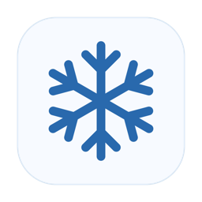

<p align="center"></p>

# Snowcap

**Interactive desktop snowfall for macOS.** Snow collects on window tops, the Dock and the bottom of the screen. Sweep it aside with the pointer, roll it into a snowball and throw it.

English · [Русский](README.ru.md)

**Requirements:** macOS 14 or later, Apple silicon or Intel. Snowcap runs from the menu bar.

[](https://raw.githubusercontent.com/eugenezolotilov-cloud/Snowcap/main/downloads/Snowcap.dmg)

> **macOS security warning.** We do not have a paid [Apple Developer Program membership](https://developer.apple.com/programs/enroll/) (US$99 per year, with local pricing where available). The published build has no Apple-issued Developer ID signature or notarization ticket, so Gatekeeper may warn that it cannot verify the app. This warning reflects the build’s verification status. You can review the [full source code](Sources/Snowhush) and [build Snowcap locally](#build-and-test) from the code you reviewed.

## Install and use

Open `Snowcap.dmg`, drag **Snowcap** into **Applications**, and launch it. The snowflake in the menu bar opens the quick controls for **intensity**, **fall speed**, **pause or resume**, and **direction**. Drag the arrow in the direction pad to tilt the snowfall up to 75° either way. Pausing hides falling flakes and keeps the chosen intensity and existing drifts.

Hold **Control (⌃)** and move the pointer along settled snow, such as the upper edge of a window. The ball grows as it picks up snow and leaves a cleared trail. Release the key to throw it in the direction of your last movement. Larger snowballs scatter farther on impact. **Advanced Settings → Interaction** lets you switch the modifier to Option or Shift, adjust collection sensitivity, or turn snowballs off.

**Advanced Settings** opens a separate window with these sections:

| Section | Controls |
| --- | --- |
| Snowfall | Intensity, speed, opacity, direction, pause and clear snow |
| Accumulation | Accumulation, snow on windows, accumulation rate, maximum depth and melting speed |
| Interaction | Snow physics, desktop interaction and snowball controls |
| Display | Behind windows, over full-screen apps, screenshots and maximum performance |
| General | Launch at login, restore snowfall defaults and quit |

## How it works

- **AppKit and SwiftUI.** AppKit manages the menu bar and transparent, click-through overlays. SwiftUI builds the separate settings window. Preferences are stored locally with `UserDefaults`.
- **Swift and Metal.** The CPU simulation advances particles, snowballs and snow height fields. Metal draws flakes, powder and drifts in per-display overlays, including a dedicated strip for snow on the Dock.
- **Window tracking.** Core Graphics window snapshots identify surfaces and occlusion. The tracker uses optional macOS window-server APIs for details such as Spaces and rounded window corners. Window behavior can vary across macOS versions.
- **Performance.** The app shares window data where possible, skips collision checks above the highest reachable surface and reduces rendering work when the snow is idle or the display sleeps. Power settings and the active scene affect resource use. [Performance notes](docs/PERFORMANCE.md)

## Build and test

Use macOS with Xcode or its Command Line Tools. Swift Package Manager resolves the pinned Sparkle dependency.

```sh
./build.sh
open build/Snowcap.app
./scripts/check-snowballs.sh
```

The build creates a universal app with an ad hoc signature by default. To build the themed installer, make [dmgbuild](https://github.com/dmgbuild/dmgbuild) available on your PATH, or set `DMGBUILD` to its executable path, then run `./scripts/package-dmg.sh`. It writes `dist/Snowcap.dmg`. For public binary distribution, use a Developer ID build and notarize the installer. See the [release preparation notes](docs/RELEASE.md).

## Credits and license

Snowcap is a macOS fork of [Snowhush by Mykhailo Bezruchko](https://github.com/mbezruchko/Snowhush), based on [upstream commit `4b6e9ec`](https://github.com/mbezruchko/Snowhush/commit/4b6e9ec0e02181c5b063285ec4eb8f69d3fd742f). Snowhush provides the original snowfall, accumulation and window tracking. Snowcap adds interactive snowballs, a direction pad, quick controls, a separate settings window and a winter-themed installer. This repository packages the macOS edition of Snowcap.

The project retains the [PolyForm Noncommercial License 1.0.0 and required copyright notice](LICENSE). [Sparkle](https://github.com/sparkle-project/Sparkle) is included under [its own license](licenses/Sparkle.txt). The Snowcap build has no upstream update feed configured.
