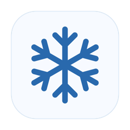

<p align="center"></p>

# Snowcap

**Интерактивный снегопад на рабочем столе macOS.** Снег копится на верхних кромках окон, в Dock и внизу экрана. Его можно разгребать курсором, скатывать в снежки и бросать.

[English](README.md) · Русский

**Требования:** macOS 14 и новее, Apple silicon или Intel. Snowcap работает из строки меню.

[](https://raw.githubusercontent.com/eugenezolotilov-cloud/Snowcap/main/downloads/Snowcap.dmg)

> **Предупреждение macOS.** У проекта нет платного участия в [Apple Developer Program](https://developer.apple.com/programs/enroll/). Оно стоит 99 долларов США в год, в некоторых регионах действует местная цена. У опубликованной сборки нет подписи Developer ID и нотариального подтверждения Apple, поэтому Gatekeeper может предупредить, что не может проверить приложение. Предупреждение относится к статусу проверки сборки. Вы можете изучить [полный исходный код](Sources/Snowhush) и [собрать Snowcap самостоятельно](#сборка-и-тесты) из проверенного вами кода.

## Установка и управление

Откройте `Snowcap.dmg`, перетащите **Snowcap** в **«Программы»** и запустите. Снежинка в строке меню открывает быстрые настройки **интенсивности**, **скорости падения**, **паузы** и **направления**. Потяните стрелку в квадратном регуляторе, чтобы наклонить снегопад до 75° в любую сторону. Пауза скрывает падающие снежинки и сохраняет выбранную интенсивность и накопившийся снег.

Зажмите **Control (⌃)** и проведите курсором по снегу, например вдоль верхней кромки окна. Снежок растёт, собирая снег и оставляя очищенную дорожку. Отпустите клавишу, чтобы бросить его по направлению последнего движения. Чем крупнее снежок, тем дальше разлетаются осколки. В разделе **«Расширенные настройки → Взаимодействие»** можно выбрать Option или Shift, изменить чувствительность сбора или отключить снежки.

**«Расширенные настройки»** открывают отдельное окно с пятью разделами:

| Раздел | Что можно настроить |
| --- | --- |
| Снегопад | Интенсивность, скорость, непрозрачность, направление, пауза и уборка снега |
| Накопление | Включение накопления и снега на окнах, скорость накопления, максимальная высота сугробов и таяние |
| Взаимодействие | Физика снега, взаимодействие с рабочим столом и управление снежками |
| Отображение | Снег за окнами, поверх полноэкранных приложений, на снимках экрана и режим максимальной производительности |
| Общие | Запуск при входе, восстановление настроек снегопада и выход |

## Как это устроено

- **AppKit и SwiftUI.** AppKit управляет строкой меню и прозрачными слоями, через которые проходят клики. На SwiftUI построено окно настроек. Параметры хранятся локально в `UserDefaults`.
- **Swift и Metal.** На процессоре рассчитываются движение частиц и снежков, столкновения и высота сугробов. Metal отрисовывает снег на каждом дисплее, включая отдельный слой для снега на Dock.
- **Отслеживание окон.** Снимки списка окон из Core Graphics определяют поверхности и перекрытия. Для некоторых деталей, например Spaces и скругления углов, приложение использует дополнительные API оконного сервера. Поведение может отличаться в разных версиях macOS.
- **Производительность.** Snowcap переиспользует данные об окнах, пропускает проверки столкновений выше всех доступных поверхностей и уменьшает нагрузку, когда снег неподвижен или дисплей спит. Потребление ресурсов зависит от сцены и настроек питания. [Замеры и оптимизации](docs/PERFORMANCE.md)

## Сборка и тесты

Понадобится Mac с Xcode или инструментами командной строки Xcode. Swift Package Manager загружает закреплённую версию Sparkle.

```sh
./build.sh
open build/Snowcap.app
./scripts/check-snowballs.sh
```

По умолчанию создаётся универсальное приложение с локальной подписью. Для сборки оформленного DMG понадобится [dmgbuild](https://github.com/dmgbuild/dmgbuild) в PATH или указанный в переменной `DMGBUILD`. Запустите `./scripts/package-dmg.sh`, чтобы получить `dist/Snowcap.dmg`. Для публичной раздачи готового приложения подпишите его через Developer ID и отправьте образ на нотариализацию. См. [заметки для релиза](docs/RELEASE.md).

## Происхождение и лицензия

Snowcap — форк [Snowhush Михаила Безручко](https://github.com/mbezruchko/Snowhush) для macOS, основанный на [коммите `4b6e9ec`](https://github.com/mbezruchko/Snowhush/commit/4b6e9ec0e02181c5b063285ec4eb8f69d3fd742f). Из Snowhush взяты исходная симуляция снегопада, накопление снега и отслеживание окон. Snowcap добавляет интерактивные снежки, регулятор направления, компактное меню, отдельное окно настроек и зимнее оформление установщика. Здесь собрана версия Snowcap для macOS.

В проекте сохранены [PolyForm Noncommercial License 1.0.0 и обязательное уведомление об авторстве](LICENSE). [Sparkle](https://github.com/sparkle-project/Sparkle) включён на условиях [своей лицензии](licenses/Sparkle.txt). Сборка Snowcap не подключена к ленте обновлений Snowhush.
